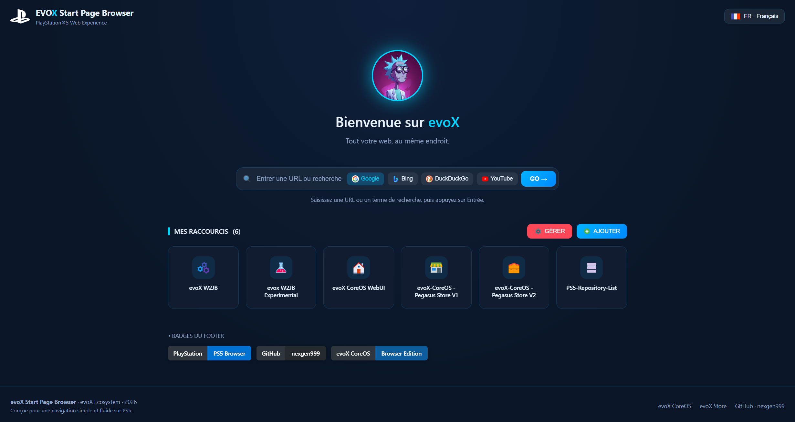

# 🌐 evoX-CoreOS Start-Page

 

---

## 🇬🇧 English

### 🚀 Overview
**evoX-CoreOS Start-Page** is a sleek, responsive web start page designed specifically for the PlayStation 5 browser experience. It serves as a unified portal, giving you direct access to all projects within the **evoX** ecosystem.

### ✨ Key Features
- 🎮 **PS5 Optimized:** Designed for smooth navigation using the PS5 controller/browser.
- 🔗 **evoX Ecosystem Hub:** Centralized direct links to all evoX releases and tools.
- 🌐 **Bilingual Support:** Switch easily between **French** and **English** interfaces.
- ➕ **Custom URL Shortcuts:** Add your own custom shortcuts in seconds using the **"+ Add"** button.
- 🖼️ **Smart Icon Fetching:** Provide a custom icon URL for any bookmark, or leave it empty and the app will automatically fetch the website's favicon.

### 📥 Direct Download
Download the latest `.pkg` installer directly:
👉 [**Download EVXS40000.pkg (v1.00)**](https://github.com/nexgen999/evoX-CoreOS_Start-Page/releases/download/v1.00/EVXS40000.pkg)

---

## 🇫🇷 Français

### 🚀 Présentation
**evoX-CoreOS Start-Page** est une page d'accueil web conçue spécialement pour le navigateur de la PlayStation 5. Elle offre un point d'accès rapide et centralisé à l'ensemble des projets et outils de l'écosystème **evoX**.

### ✨ Fonctionnalités
- 🎮 **Optimisé pour PS5 :** Interface fluide et intuitive adaptée à la navigation sur console.
- 🔗 **Écosystème evoX :** Accès direct en un clic à l'ensemble des projets evoX.
- 🌐 **Support Bilingue :** Entièrement disponible en **Français** et en **Anglais**.
- ➕ **Raccourcis Personnalisés :** Ajoutez simplement vos propres liens grâce au bouton **"+ Ajouter"**.
- 🖼️ **Gestion Intelligente des Icônes :** Renseignez une image personnalisée ou laissez le champ vide pour que la favicon du site soit récupérée automatiquement.

### 📥 Téléchargement Direct
Téléchargez le fichier d'installation `.pkg` :
👉 [**Télécharger EVXS40000.pkg (v1.00)**](https://github.com/nexgen999/evoX-CoreOS_Start-Page/releases/download/v1.00/EVXS40000.pkg)